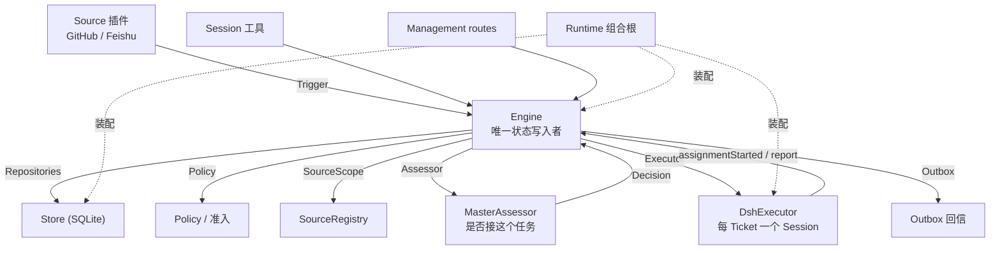

# ARCHITECTURE — 当前实现与计划分层

> 上半部分是**实测的上游结构**；下半部分标注 `[PLANNED]` 的是本项目拟新增、尚未创建的部分。
> 不得把 `[PLANNED]` 当作已实现能力引用。

## 1. 上游实际数据流（`docs/007-architecture.md` + 源码核对）



关键语义（来自源码与架构文档，已核对）：

1. `Engine` 全部方法**同步**，每个命令一个事务；跨部件命令按 `Intake→Evals→Tickets→Assignments→Replies` 顺序调用。
2. 对外只暴露角色化 `Pick`：`EngineForSources / EngineForMainSession / EngineForPeople / EngineForSettings / EngineForExecutor`。
3. 端口在 `src/core/ports.ts` 定义；适配器在事务提交后执行外部动作。
4. `MasterAssessor` 职责是**授权与准入判断**，不是模型选择器 → 蓝图 ADR-003 的落点。
5. `DomainEvents` 已定义 12 类事件，`Runtime` 只消费 3 类 → 轨迹采集的天然挂载点。

## 2. 三类修改面的物理隔离

| 面 | 物理位置 | 谁能改 | 现状 |
|---|---|---|---|
| **A. 任务工作区** | `workspaces/tickets/<ticket_id>/` `[PLANNED]` | 任务内 Agent | 未创建 |
| **B. 可进化 Harness 面** | `src/research/`、`src/evolution/`、`prompts/`、`skills/` | 仅影子评估通过的候选 | 未创建 |
| **C. 受保护信任根** | 独立目录 + 独立进程，候选容器内不可读 | 仅运维 | 未创建 |

**硬约束**：B 的候选 patch 若触碰 C 的路径或评测器，必须 `REJECT_SECURITY`，且该判定由固定代码执行，不由 LLM 自报。

## 3. 新增模块（`src/research/` 与 `scientific/` 已实现；`src/evolution/`、`evolution/` 仍为 `[PLANNED]`）

**执行面收紧（B-005 缓解）**：worker 与主 Session 的允许工具列表都已移除 shell 工具。DSH 的文件工具受 `dsh-fs-sandbox` 的可写根约束，shell 是唯一没有路径沙箱的通用工具。Ticket 读取数据快照时使用 `EVOVS_DATA_ROOT` 指向的**只读根**（输入可绝对路径，输出仍必须落在 ticket 目录）。

```
src/research/          # 【已实现】
  registry.ts          #   白名单工具：能力/失败码/zod 输入/固定 argv
  job-runner.ts        #   沙箱执行：shell:false、独立进程组、墙钟强杀、sha256 清单
  tools.ts             #   worker 工具：discovery + run + job(status/read/cancel/list)

src/evolution/         # 候选协调端口（TS）
  candidate-types.ts / trace-collector.ts / version-registry.ts / evolution-hooks.ts

scientific/            # 【部分实现】Python 科研环境
  src/evovs_science/{cli,schemas,manifest,chemistry/featurize,modeling/train}/
  # data/ evaluation/ screening/ 仍待 Phase 2

evolution/             # 独立 RSI 控制器（不在候选信任边界内）
  diagnosis/ shadow_eval/ selection/ candidate_editor/ run_evolution.py
```

## 4. 两条闭环与数据单向边界

```
Task Loop（内环）     : 目标 → 规划 → 执行 → 度量 → 调整 → 交付（允许训练下游 QSAR/DTI 模型）
Evolution Loop（外环）: 轨迹诊断 → 候选 patch（隔离 worktree）→ 影子任务评估 → Pareto → 接受/回滚
```

- 外环**不训练任何元模型**，LLM 权重固定；
- 受保护评测器只回传聚合指标与有限诊断，**不回流测试集分子身份、标签与逐样本错误**；
- 任务级改进（换模型/调参）**不等于** Harness 进化，判定见蓝图 §2.2 六条。

## 5. 与上游的耦合策略

| 依赖 | 策略 |
|---|---|
| `Runtime` / `Engine` / `Store` / `Policy` | 保留，仅通过 Ports 扩展 |
| `DshExecutor` | 保留；新增科研作业桥接作为其下游能力 |
| 版本 | `package.json` 原样保留；Node 用户态固定 v22.23.4；运行时 pin `0.2.1-rc.5`（记录于 `UPSTREAM.md`） |
| 升级 | 任何上游升级必须重跑 `pnpm check` 并更新本文件与 `UPSTREAM.md` 的 SHA |
